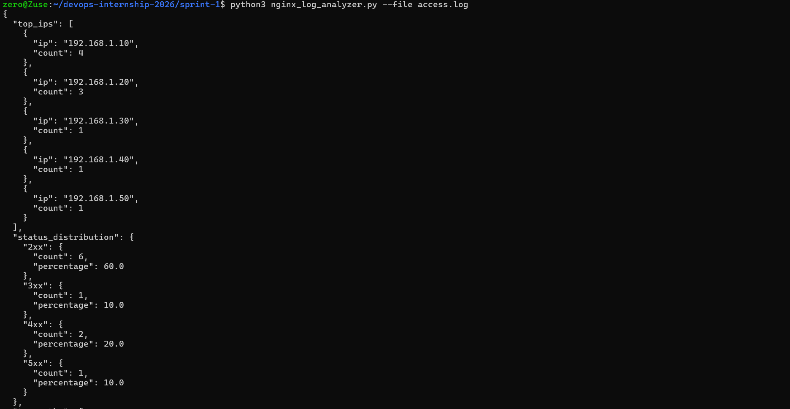
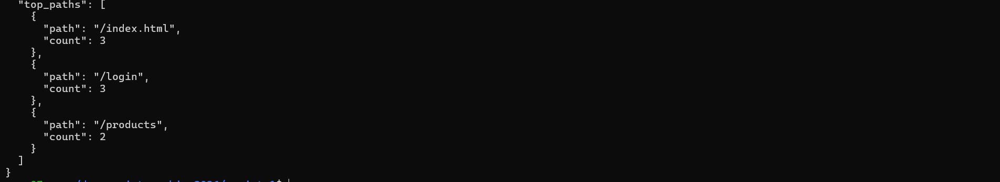

# Sprint 1 – Nginx Log Analyzer

## Overview

A Python CLI script that parses standard Nginx access logs and generates basic traffic analytics in JSON format.

## Requirements

* Python 3
* Standard Nginx access log
* No external Python packages are required

## Project Structure

```text
sprint-1/
├── nginx_log_analyzer.py
├── access.log
├── README.md
└── proof/
    ├── execution-1.png
    └── execution-2.png
```

## How It Works

The script reads the Nginx log file line by line and uses a regular expression to extract:

* Client IP address
* HTTP request method
* URL path
* HTTP status code

The extracted data is counted using Python dictionaries.

The IP counts are sorted to find the top 5 IP addresses, while the URL path counts are sorted to find the top 3 requested paths.

HTTP status codes are grouped into `2xx`, `3xx`, `4xx`, and `5xx`. The count and percentage of each group are then calculated.

Finally, the results are converted to formatted JSON and printed to standard output.

## Usage

Run the analyzer using the included sample log:

```bash
python3 nginx_log_analyzer.py --file access.log
```

A different Nginx log file can also be supplied:

```bash
python3 nginx_log_analyzer.py --file /path/to/access.log
```

## Input Example

A standard Nginx access log contains information similar to:

```text
192.168.1.10 - - [01/Oct/2026:10:20:30 +0530] "GET /index.html HTTP/1.1" 200 1024
```

The script extracts the IP, request method, path, and status code from each valid line.

## Output

The JSON output contains:

* Top 5 IP addresses and their request counts
* `2xx`, `3xx`, `4xx`, and `5xx` status counts and percentages
* Top 3 requested URL paths and their request counts

Example structure:

```json
{
  "top_ips": [],
  "status_distribution": {},
  "top_paths": []
}
```

## Design Notes

* Python's built-in `argparse` module is used for command-line input.
* Regular expressions are used to extract required fields from Nginx log lines.
* Dictionaries are used for counting IPs, status groups, and URL paths.
* The built-in `json` module is used to produce structured JSON output.
* Results are printed to stdout as allowed by the task requirements.

## Error Handling

* A missing log file produces a clear error message.
* Invalid or unparseable log lines are skipped without stopping the analysis.
* Empty input is handled when calculating status percentages.

## Testing

The script was tested using:

* The included sample `access.log`
* The system Nginx access log
* Invalid log input
* A nonexistent log file

## Proof of Work

The script was successfully executed using the sample log:

```bash
python3 nginx_log_analyzer.py --file access.log
```

Execution output:




